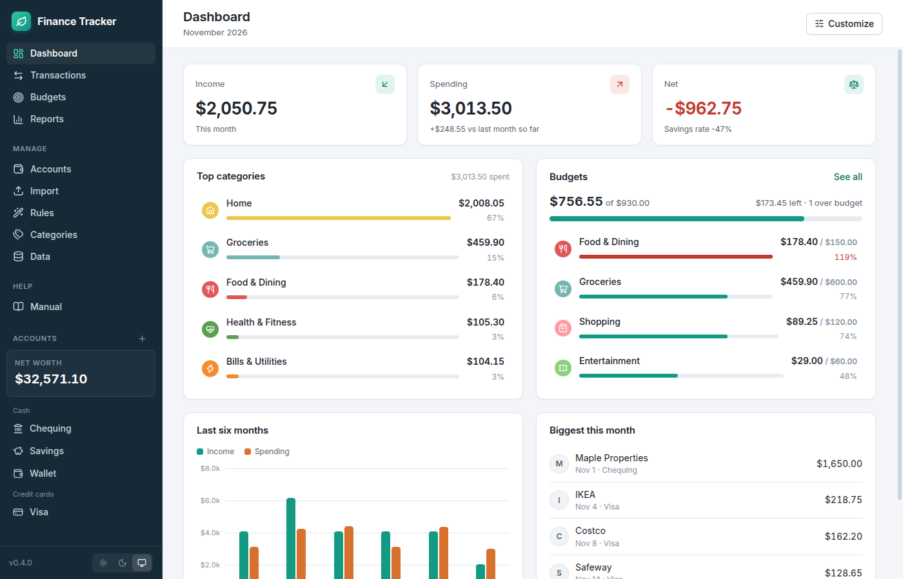
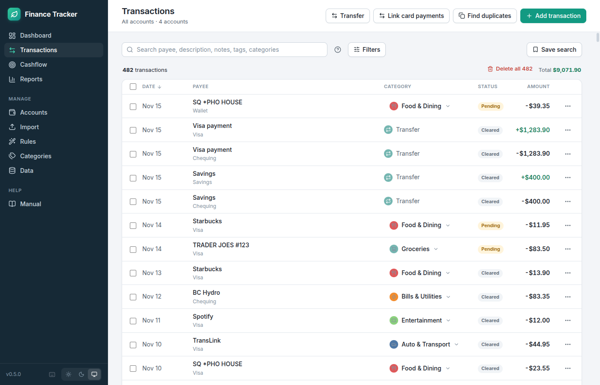
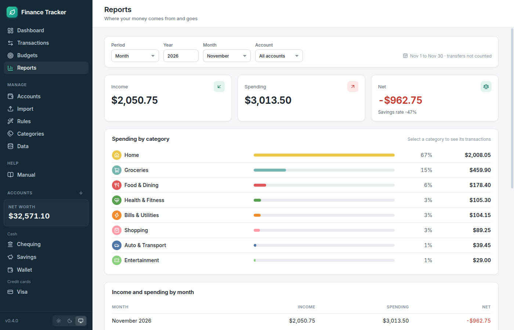
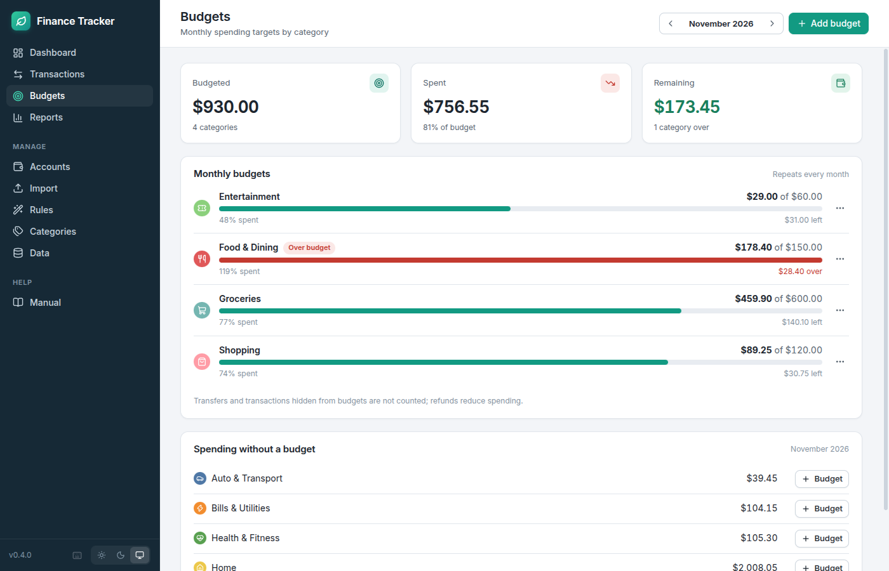
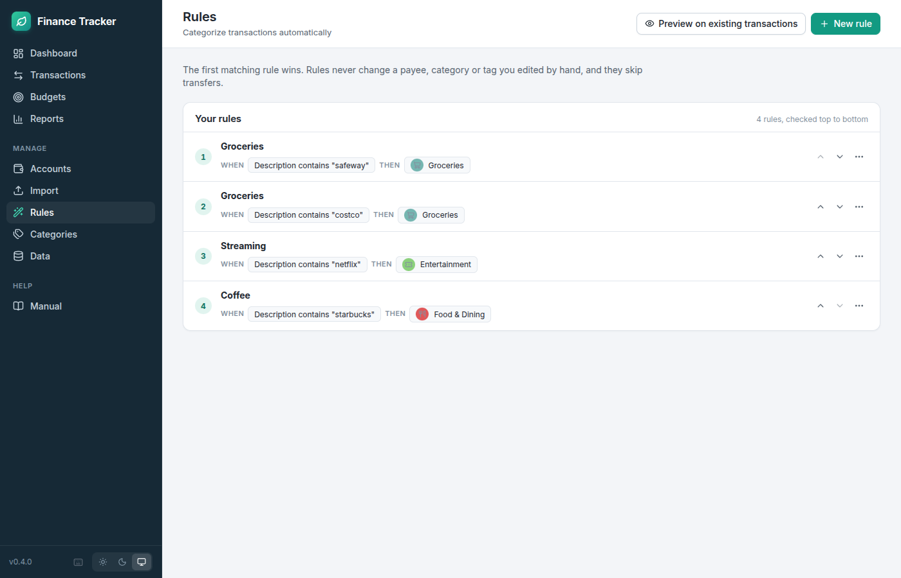
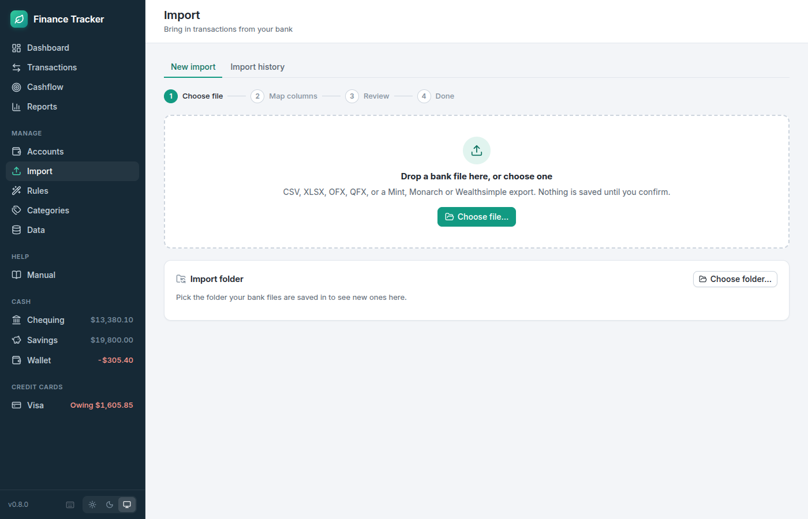
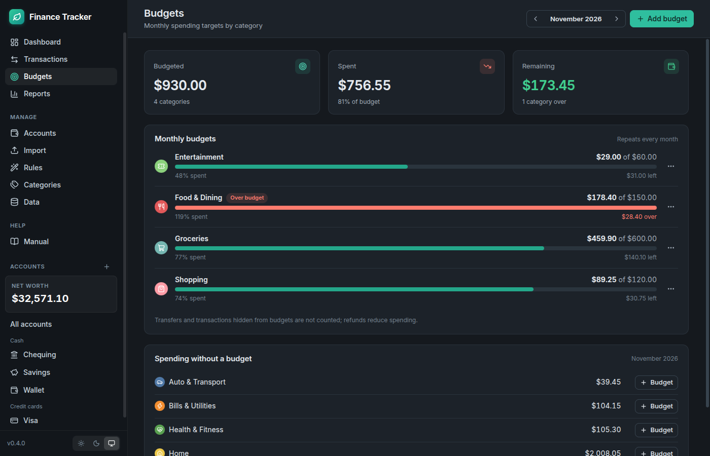

# Finance Tracker

[](https://github.com/ricschuster/finance-tracker/actions/workflows/ci.yml)
[](https://github.com/ricschuster/finance-tracker/releases/latest)
[](LICENSE)

A private personal finance organizer in the spirit of Intuit Mint. Add or import
your transactions, let rules sort them into categories, search everything, and
see where the money goes each month. There are no bank connections and no
account to create: your data lives in a single file on your own computer.

<picture>
  <source media="(prefers-color-scheme: dark)" srcset="docs/images/dashboard-dark.png">
  
</picture>

## Features

- **Accounts and transactions.** Chequing, savings, credit card, cash and loan
  accounts with running balances and a net worth total. Split a transaction
  across categories, add notes and tags, and record transfers between accounts.
- **Import.** CSV, spreadsheet (`.xlsx`), OFX and QFX files, plus Mint, Monarch
  and Wealthsimple exports. Presets for RBC, TD and Tangerine, saved column
  mappings, duplicate detection, a preview before anything is saved, and undo
  for any import. A watched folder shows new bank files as they appear.
- **Rules.** An ordered list of rules (first match wins) cleans up the payee,
  sets the category and adds tags. Preview a rule against existing
  transactions before you apply it. Edit a category by hand and the app offers
  to turn it into a rule. Rules never overwrite something you set yourself.
- **Search.** Full-text search across payee, description, notes, tags and
  categories, with filters, saved searches, totals and bulk actions.
- **Reports and dashboard.** Spending by category, income versus expenses,
  trends, top payees and the biggest transactions, with drill-down to the
  transactions behind every figure. The dashboard is customizable.
- **Cashflow.** Income, spending and net by month, a spending-by-category donut and a searchable category list that drills into transactions.
- **Data safety.** Automatic backups, database export and restore, and a CSV
  export of your transactions.
- **Light and dark themes**, and an in-app manual.

## Screenshots

All screenshots use a synthetic demo database. No real data is shown.

| Transactions | Reports |
| --- | --- |
|  |  |
| **Cashflow** | **Rules** |
|  |  |
| **Import** | **Dark theme** |
|  |  |

## Install

Download the installer for your system from the
[latest release](https://github.com/ricschuster/finance-tracker/releases/latest).
Builds are unsigned, so the first launch shows a warning:

- **macOS:** pick the dmg for your Mac: `mac-arm64` for Apple silicon (M1 and
  later), `mac-x64` for Intel (Apple menu, About This Mac shows which). Drag the
  app to Applications and open it. When macOS says it cannot verify the app,
  choose Done, then open System Settings, Privacy & Security and click Open
  Anyway. Alternatively run
  `xattr -dr com.apple.quarantine "/Applications/Finance Tracker.app"` once.
- **Windows:** in SmartScreen choose More info, then Run anyway.
- **Linux:** `chmod +x` the AppImage and run it.

There is no auto-update. Install a newer version over the old one and your data
is kept. See [packaging](docs/design/09_packaging.md) and
[ADR 0004](docs/decisions/0004-unsigned-manual-update-releases.md) for why.

## Your data and privacy

- Everything is stored in one SQLite file on your machine. The app makes no
  network requests with your data and has no telemetry.
- Back up with the Data tab (automatic backups, export and restore).
- This repository contains only synthetic sample data under `test-data/`.
  Please never attach real statements to an issue.

## Try it without your own data

```bash
npm ci
npm run dev:demo   # launches on a synthetic demo database in .dev-data/
```

The demo database is separate from your real one. `npm run dev:demo:reset`
wipes it.

## Development

Electron, TypeScript, React and SQLite (better-sqlite3). Business logic (the
rules engine, import parsers, reports) is framework-free under `src/core/` and
unit tested. See [CONTRIBUTING.md](CONTRIBUTING.md) for setup and conventions,
`docs/design/` for the design notes, and `docs/decisions/` for the architecture
decision records. Start with the
[project brief](docs/design/00_project_brief.md).

## Scope

In scope: manual entry, file import, accounts, categories, rules, search,
reports and budgets. Out for now: bank syncing, multi-user, mobile apps and
investment tracking. The app assumes one home currency (CAD) and ISO dates.

## Contributing

Bug reports, feature ideas and pull requests are welcome. Open an
[issue](https://github.com/ricschuster/finance-tracker/issues) first for
anything large. Report security problems as described in
[SECURITY.md](SECURITY.md).

## License

[GNU General Public License v3.0](LICENSE).
